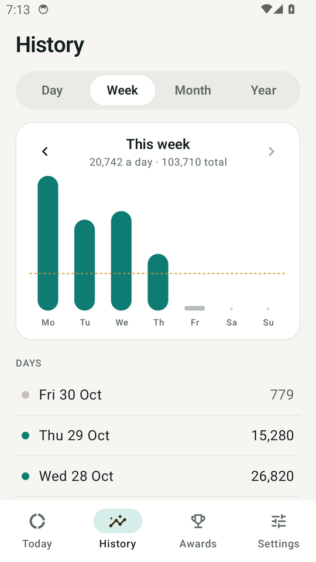
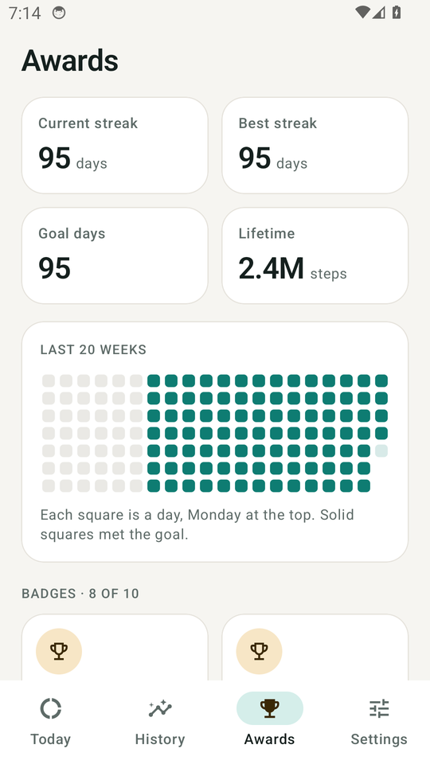
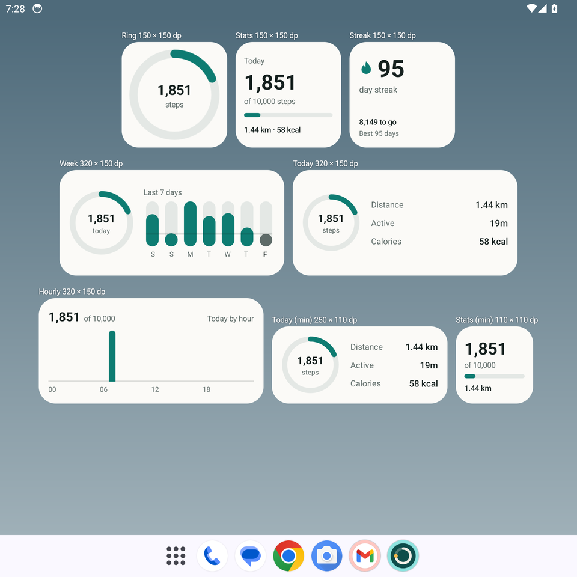

# Pedometer

A step counter for the Galaxy Z Fold 8 (Android 11 and later). It counts steps with the phone's
hardware step sensor, merges them with a Fitbit (or any wearable) through Health Connect without
double counting, and writes the phone's steps back to Health Connect only for times the wearable
wasn't worn.

  
  
  

- `core/`: the rules, in plain Kotlin with unit tests: 5-minute slot merging and dedupe, the
  Health Connect write filter, step counter reboots, streaks, badges, CSV.
- `app/`: the Android app: Compose UI (cover and inner screen layouts), Room, Hilt, step
  reading (Google Play step recording, or the step chip every 15 minutes), Health Connect sync, WorkManager jobs, Glance widgets.
- `.github/workflows/android.yml`: every push to `main` runs the unit tests, builds the APK,
  publishes it as a release, and runs the screen tests on emulators at the Fold's cover and
  inner screen sizes.

Open the folder in Android Studio and run the `app` configuration to build a debug APK yourself.
